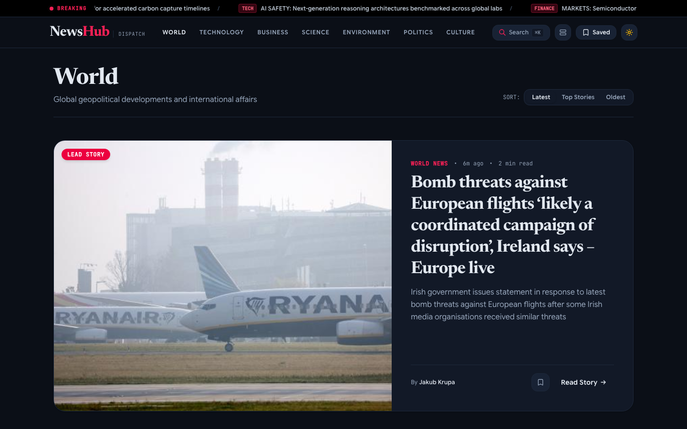

# NewsHub 🗞️
### Real-Time Curated Global Journalism & Intelligence

<div align="center">
  
  <br />
  <h3><i>"Informed Perspectives. Modern Editorial Velocity."</i></h3>

  <p>
    <a href="https://kanishk-upadhyay.github.io/news/">
      
    </a>
    <a href="https://github.com/kanishk-upadhyay/news/actions/workflows/deploy.yml">
      
    </a>
    <a href="https://react.dev/">
      
    </a>
    <a href="https://vite.dev/">
      
    </a>
    <a href="https://tailwindcss.com/">
      
    </a>
    <a href="LICENSE">
      
    </a>
  </p>

  <br />
  
</div>

---

### 🌐 Overview
**NewsHub** is a production-grade editorial intelligence platform that delivers real-time global news with the typographic gravitas of world-class newsrooms (*The New York Times*, *The Guardian*, *Financial Times*).

Engineered with **React 19**, **Tailwind CSS v4**, and the **Guardian Open Platform API**, it replaces flat, repetitive AI card grids with an asymmetric journalistic layout featuring dominant Lead Stories, live breaking tickers, distraction-free in-app reading with native voice synthesis, and offline-persistent personal archives.

---

### 📱 Responsive Multi-Surface Design

| Desktop Editorial Reading Room | Mobile Responsive Dispatch |
| :---: | :---: |
|  |  |
| *Distraction-free centered reading modal with TTS audio playback* | *Fluid single-column stack, single hamburger drawer, 48px touch targets* |

---

### ✨ Key Capabilities & Engineering Craftsmanship

* **📰 Asymmetrical Editorial Front-Page**: Dominant Lead Story Hero with high-resolution imagery, editorial bylines, reading time estimates, and category taxonomy.
* **🔗 Clean HTML5 History Routing**: Built with `BrowserRouter` using `basename="/news"` paired with a client-side SPA redirect bridge (`public/404.html` + `index.html` decode script). No clumsy `/#/` hash fragments; clean URLs (`https://kanishk-upadhyay.github.io/news/`) and direct deep-linking work out of the box.
* **📖 Centered Distraction-Free Reading Room**: Focus modal offering fluid font scaling, reading progress bar, drop-cap typography, and native browser **SpeechSynthesis (Text-to-Speech)** read-aloud.
* **🔬 Ergonomics & Contrast Science**:
  * **Light Theme**: Natural warm paper tone (`#FAF8F5`) with deep carbon ink (`#111827`), delivering APCA $L^c \approx 98$ contrast without ocular glare.
  * **Dark Theme**: Softened chalk ivory (`#E2E8F0`) on matte obsidian (`#0B0F17`), actively eliminating the **astigmatism halation effect** that plagues dilated pupils looking at stark `#FFFFFF` text.
  * **System Sync**: Zero-FOUC inline blocking script detects OS `prefers-color-scheme` instantly and syncs in real-time with `window.matchMedia`.
* **📐 Flush Grid Pagination**: Total card count (17 articles + 1 inline Load More tile = 18 slots) is perfectly divisible by both 2 and 3 columns, eliminating trailing orphaned grid holes.
* **⚡ Live Breaking Ticker**: Sticky marquee streaming live dispatches with hover/touch pause.
* **🔍 Instant Omni-Search**: Debounced keyword queries (`q`) with quick-topic pills and keyboard trigger (`⌘K` or `/`).
* **🔖 LocalStorage Defense**: Curated offline archives that sanitize payloads to <1KB per bookmark, protecting against browser `QuotaExceededError`.
* **🛡️ 429 Resilience Layer**: Smart 5-minute memory and `sessionStorage` caching engine that stops API rate-limit exhaustion during rapid category switching.

---

### 🏗️ Architecture & Data Flow

```text
[ Guardian Open Platform ]
            │
            ▼
   [ NewsApi Client ] ──► [ 5-Minute In-Memory / Session Storage Cache ]
                                     │ (hit / miss)
                                     ▼
                          [ React 19 App State ]
                           ├── AppContext (Theme, Bookmarks, Audio, Search)
                           └── Browser History Router (Clean URLs, 404 SPA Bridge)
                                     │
           ┌─────────────────────────┼─────────────────────────┐
           ▼                         ▼                         ▼
     [ HeroCard ]           [ NewsFeed Grid ]           [ ReaderDrawer ]
  (Lead Story Hero)       (Magazine / Compact List)     (TTS & Drop-Cap)
```

---

### 📂 Repository Structure

```text
news/
├── .github/
│   └── workflows/
│       └── deploy.yml       # Automated GitHub Pages CI/CD pipeline
├── assets/                  # High-resolution screenshots & showcase media
│   ├── preview-hero.png     # Front page editorial hero preview
│   ├── preview-mobile.png   # Mobile viewport feed preview
│   └── preview-reader.png   # Centered reading room preview
├── public/
│   ├── 404.html             # GitHub Pages SPA history redirect bridge
│   ├── favicon.svg          # Vector newspaper logo
│   └── manifest.json        # PWA Web App Manifest
├── src/
│   ├── api/
│   │   └── NewsApi.js       # Guardian API client with in-memory caching
│   ├── components/
│   │   ├── BreakingTicker.jsx # Marquee breaking news ticker
│   │   ├── HeroCard.jsx     # High-impact lead story card
│   │   ├── Navbar.jsx       # Integrated top header with prominent categories
│   │   ├── NewsCard.jsx     # Modular card supporting Magazine & Digest views
│   │   ├── ReaderDrawer.jsx # Centered reading modal with TTS audio player
│   │   ├── SearchModal.jsx  # Global instant search modal
│   │   ├── SkeletonCard.jsx # Editorial loading shimmer skeletons
│   │   └── Toast.jsx        # Non-intrusive action feedback toasts
│   ├── constants/
│   │   └── index.js         # Categories, configuration, and defaults
│   ├── context/
│   │   ├── AppContext.jsx   # Theme, bookmarks, and reader state provider
│   │   ├── appContextDef.js # Context definitions
│   │   └── useApp.js        # useApp consumer hook
│   ├── pages/
│   │   ├── Bookmarks.jsx    # Saved articles library with search filter
│   │   └── NewsFeed.jsx     # Flush grid feed with integrated load more
│   ├── utils/
│   │   ├── textUtils.js     # HTML entity decoders, date & read-time calculations
│   │   └── styles.js        # Design tokens and Tailwind utility classes
│   ├── App.jsx              # BrowserRouter root and routing layout
│   ├── index.css            # Tailwind v4, editorial fonts, and color tokens
│   └── main.jsx             # React 19 root
├── eslint.config.js         # Modern ESLint 9 flat configuration
├── index.html               # FOUC theme detector, SEO metadata, and fonts
├── LICENSE                  # MIT License
├── package.json             # Project metadata and dependencies
└── vite.config.js           # Vite configuration with Tailwind v4 plugin
```

---

### 🚀 Getting Started

#### Prerequisites
* **Node.js** >= 18.x
* **npm** >= 9.x

#### 1. Clone the repository
```bash
git clone https://github.com/kanishk-upadhyay/news.git
cd news
```

#### 2. Install dependencies
```bash
npm install
```

#### 3. Configure API Key (Optional)
The application includes a public developer tier key by default. For production rate limits, register for a free key at [The Guardian Open Platform](https://open-platform.theguardian.com/access/) and copy `.env.example`:
```bash
cp .env.example .env
```
```env
VITE_GUARDIAN_API_KEY=your_guardian_api_key_here
```

#### 4. Run Development Server
```bash
npm run dev
```
Open [http://localhost:5173/news/](http://localhost:5173/news/) in your browser.

#### 5. Verify & Build
```bash
npm run lint
npm run build
npm run preview
```

---

### 📜 License
MIT License © [Kanishk Upadhyay](https://github.com/kanishk-upadhyay)
